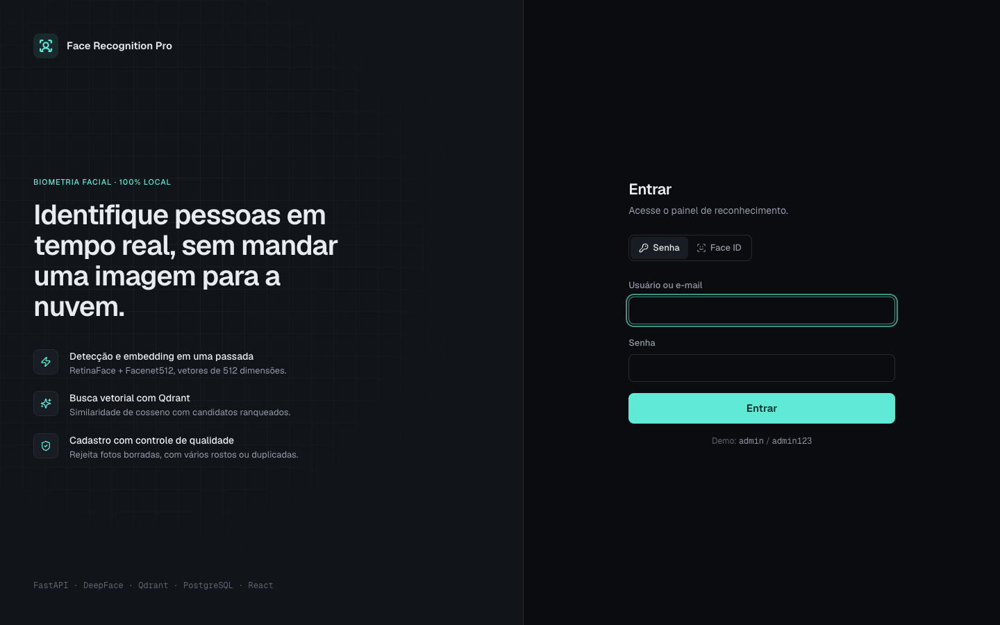
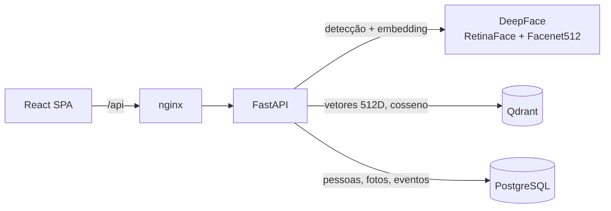

# Face Recognition Pro

Reconhecimento facial self-hosted: cadastre pessoas com algumas fotos e identifique-as pela câmera em tempo real, por upload ou no login por Face ID. Tudo roda na sua máquina. Nenhuma imagem sai para serviços externos.



**Stack:** FastAPI · DeepFace (RetinaFace + Facenet512) · Qdrant · PostgreSQL · React 18 · TypeScript · Tailwind · React Query

## Funcionalidades

- **Reconhecimento ao vivo.** A câmera identifica todos os rostos do quadro algumas vezes por segundo e desenha caixas com nome e similaridade. A prévia não polui o histórico. O botão "Capturar e registrar" grava o evento.
- **Reconhecimento por upload.** Aceita vários rostos por foto. Para cada rosto, mostra os candidatos ranqueados contra o limiar.
- **Cadastro com controle de qualidade.** Fotos sem rosto, com mais de uma pessoa, borradas ou escuras são recusadas com o motivo. Um rosto que já pertence a outra pessoa também é recusado, o que evita cadastro duplicado.
- **Face ID.** O operador cadastra o próprio rosto em Configurações e passa a entrar olhando para a câmera. O login usa um limiar mais rígido do que a identificação comum.
- **Painel.** KPIs, resultados por dia, horários de pico e pessoas mais reconhecidas, tudo no fuso de quem acessa.
- **Histórico auditável.** Cada reconhecimento e cada tentativa de Face ID (aceita, negada ou desconhecida) fica registrada, com filtros.

## Como funciona



1. **Detecção e embedding em uma passada.** Uma única chamada a `DeepFace.represent` encontra os rostos com RetinaFace, alinha e gera um vetor de 512 dimensões com Facenet512.
2. **Busca vetorial.** Cada foto cadastrada é um ponto no Qdrant, com id igual ao da linha em `face_samples`. A busca traz os vizinhos mais próximos por cosseno.
3. **Ranqueamento por pessoa.** Os acertos são agrupados por pessoa, e a nota de cada uma é a da sua melhor foto (`app/face/matching.py`). A pessoa só é identificada se passar do limiar.
4. **Auditoria.** Cada rosto analisado vira um evento em `recognition_events`.

### Decisões de projeto

| Decisão | Motivo |
| --- | --- |
| Limiar de **0,70** de similaridade (0,78 no Face ID) | Equivale à distância de cosseno 0,30 que o próprio DeepFace usa para Facenet512. A versão anterior usava 0,60 e aceitava falsos positivos. |
| `face_samples.id` = id do ponto no Qdrant | Apagar uma foto remove exatamente o vetor dela. A contagem de fotos sai de um `COUNT`, então não fica dessincronizada. |
| Schema aplicado no boot, de forma idempotente | `docker compose up` em banco vazio ou antigo chega ao mesmo estado, sem passo manual de migração. |
| Modelos carregam em thread separada | A API sobe na hora. Login e cadastro funcionam enquanto os pesos baixam, e o painel mostra o status. |
| Chamadas ao modelo serializadas por lock | Os modelos Keras não são seguros para uso concorrente entre threads de request. |

## Rodando

Pré-requisito: Docker. Recomenda-se reservar uns 6 GB de RAM para o Docker por causa do TensorFlow.

```bash
git clone https://github.com/PeSzpak/face-recognition-pro.git
cd face-recognition-pro
docker compose up -d --build
```

Acesse **http://localhost:8080** e entre com `admin` / `admin123`. No primeiro boot, os pesos dos modelos (~210 MB) são baixados para um volume. O indicador no canto inferior da barra lateral fica verde quando terminam.

| Serviço | URL |
| --- | --- |
| Aplicação | http://localhost:8080 |
| API (Swagger) | http://localhost:8000/docs |
| Qdrant | http://localhost:6333/dashboard |

### Desenvolvimento local

```bash
docker compose up -d postgres qdrant

cd backend
python3.10 -m venv .venv && source .venv/bin/activate
pip install -r requirements-dev.txt
cp .env.example .env
uvicorn app.main:app --reload

cd ../frontend
npm install
npm run dev          # http://localhost:5173, com proxy de /api para :8000
```

### Testes

```bash
cd backend && pytest
```

Os testes unitários cobrem o ranqueamento e o tratamento de imagem. Os de integração exercitam a API contra PostgreSQL e Qdrant reais, com um modelo facial falso e determinístico: cadastro, rejeição de rosto duplicado, identificação, exclusão, login por Face ID e estatísticas. Eles usam um banco `face_recognition_test` separado e são pulados se o Postgres não estiver acessível.

## Configuração

Variáveis do backend (veja `backend/.env.example`):

| Variável | Padrão | Descrição |
| --- | --- | --- |
| `FACE_DETECTOR` | `retinaface` | Detector do DeepFace. `opencv` é mais rápido e menos preciso. |
| `MATCH_THRESHOLD` | `0.70` | Similaridade mínima para identificar alguém. |
| `FACE_LOGIN_THRESHOLD` | `0.78` | Similaridade mínima para o login por Face ID. |
| `MIN_SAMPLE_QUALITY` | `0.35` | Qualidade mínima de uma foto de cadastro (nitidez, exposição, tamanho). |
| `SECRET_KEY` | valor de demo | Chave de assinatura dos JWT. **Troque em qualquer ambiente real.** |
| `ADMIN_PASSWORD` | `admin123` | Senha do admin criado no primeiro boot. Não sobrescreve uma senha já existente. |

## Estrutura

```
backend/app/
  face/engine.py      DeepFace: detecção + embedding, warmup, lock
  face/matching.py    ranqueamento puro, sem I/O
  face/pipeline.py    cadastro e identificação
  api/                rotas: auth, persons, recognition, stats
  schema.sql          schema idempotente
frontend/src/
  pages/              uma tela por rota
  features/           modais de cadastro de pessoa e de fotos
  components/         Camera, FaceOverlay, AppShell e o kit de UI
  lib/                cliente da API, sessão, tipos
```

## Limitações conhecidas

- **Sem prova de vida.** Uma foto impressa ou exibida numa tela pode passar no Face ID. O DeepFace oferece anti-spoofing (FasNet), mas ele exige PyTorch, o que dobraria o tamanho da imagem. É o próximo passo natural.
- **CPU.** Cerca de 1 s por imagem em um Mac M-series. Com GPU, ou trocando o detector para `opencv`, a latência cai bastante.
- **Dados biométricos.** Rostos são dados pessoais sensíveis pela LGPD. Em produção, colete consentimento explícito, defina retenção e restrinja o acesso.

## Licença

MIT. Veja [LICENSE](LICENSE).
